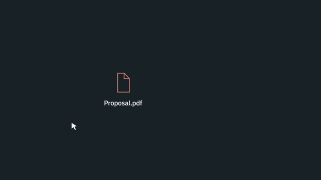
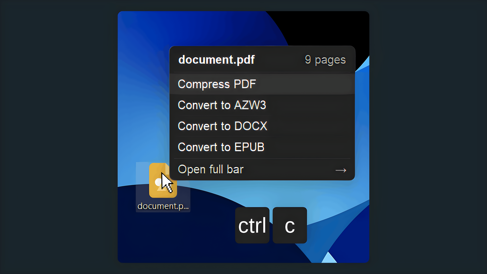

# nespatch

## What is nespatch

<h4>nespatch is a tool for using file services (like convertors) without visiting their webpages or desktop apps.</h4>

<h4>Works with:<br>
• Documents<br>
• Video<br>
• Audio<br>
• Image<br>
• Ebook</h4>

<picture></picture>

<h4 align="center">Select. Copy a file. Actions for this file type appear. Windows.</h4>

<h4>Screenshot:</h4>

<picture></picture>

<a href="https://github.com/adrianium/nespatch/releases/latest/download/nespatch_Setup.exe"></a><a href="https://www.virustotal.com/gui/file/1d929007958b311a34aa3b68705d831f21fa3af5a095f6026cdd33faaed81c0f?nocache=1"></a>


## Actions list

<h4>• Convertors (PDF to DOCX, MP4 to MP3 and etc.)<br>
• Remove Background (Image/Video)<br>
• Translate PDF with preserved layout (DeepL)<br>
• Text to Speech (Male/Female)<br>
• Audio to Text<br>
• AI Upscale (Image/Video)</h4>

<h4>list will be bigger and bigger in future.</h4>

## Build

<h4>Windows 10/11, Python 3.10+.</h4>

```
python main.py
pyinstaller packaging/build.spec --noconfirm

```

<h4>The full installer is <code>packaging/installer.iss</code>. Details are in <a href="BUILDING.md">BUILDING.md</a>.</h4>

## License

<h4><a href="LICENSE">MIT</a></h4>
